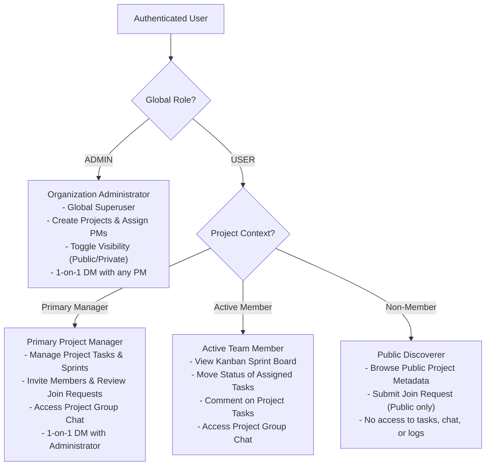
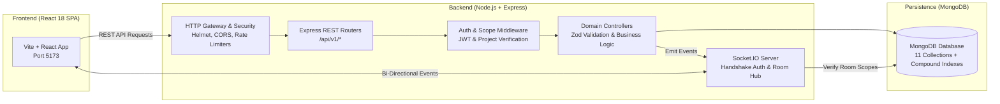
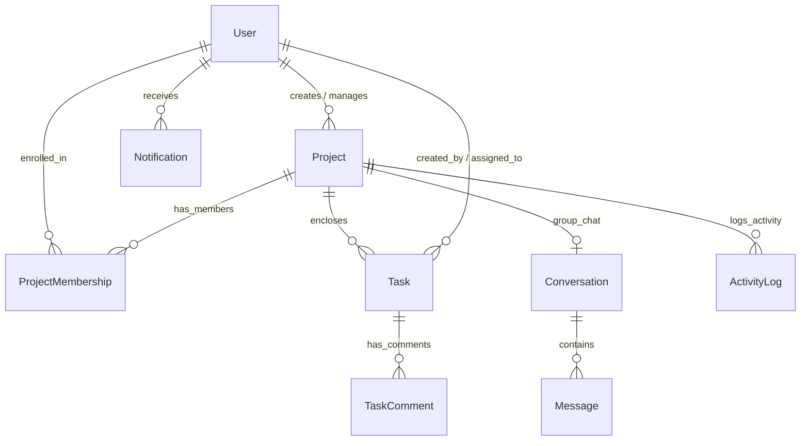

# WorkSpace

> **A full-stack, real-time team project management and collaboration platform engineered with React, Node.js, Express, MongoDB, and Socket.IO.**

---

## 1. Project Title & Introduction

**WorkSpace** is a production-grade, multi-project team collaboration SaaS platform. It combines visual Kanban sprint tracking, fine-grained role-based access control (RBAC), and contextual real-time communication—including project group chat channels and private 1-on-1 direct messaging between Administrators and Project Managers.

Engineered as a clean, modular monolith, WorkSpace enforces strict server-side authority: all permission evaluations, task ordering calculations, and concurrency checks occur on the server.

---

## 2. Problem Statement & Solution

### The Problem
Modern software and engineering teams frequently struggle with fragmented tooling:
- **Disjointed Workflows:** Project discussions occur in separate messaging apps disconnected from the task boards where work is tracked.
- **Overcomplicated Concurrency:** Collaborative drag-and-drop boards often suffer from lost updates when multiple team members move cards simultaneously, or incur high database write costs ($O(N)$ re-indexing of sibling tasks).
- **Ambiguous Authorization:** Tools often conflate organization-wide administrative privileges with project-level leadership, leading to over-permissioned team members or chaotic access boundaries.

### The Solution
WorkSpace solves these challenges through an integrated, secure, and low-latency architecture:
- **Contextual Collaboration:** Real-time group chat is directly tied to project context, complemented by isolated private direct messaging between Organization Administrators and Project Managers.
- **High-Velocity Kanban:** Card positioning uses **fractional indexing** for $O(1)$ updates and **Optimistic Concurrency Control (OCC)** to prevent accidental overwrites during concurrent edits.
- **Strict Role Scoping:** Distinguishes between global roles (`ADMIN` vs. `USER`) and dynamic project scopes (Primary Project Manager, Active Employee, and Public Discoverer).

---

## 3. Application Screenshots

WorkSpace strictly prohibits fabricated UI mockups. Screenshots are captured from the running application with seeded demo data.

The [`screenshots/`](screenshots/) directory contains genuine captures of the running platform:

| Screen | File Location | Key Capabilities Shown |
|---|---|---|
| **Public Landing Page** | [`screenshots/01-landing-page.png`](screenshots/01-landing-page.png) | Customer-facing SaaS presentation, value proposition, and workflow highlights. |
| **Authentication Screen** | [`screenshots/02-login-page.png`](screenshots/02-login-page.png) | Minimalist, focused authentication card with instant validation feedback. |
| **Workspace Dashboard** | [`screenshots/03-dashboard.png`](screenshots/03-dashboard.png) | Contextual KPI cards, project completion progress bars, and attention queue. |
| **Project Directory** | [`screenshots/04-project-directory.png`](screenshots/04-project-directory.png) | Project cards, public/private badges, and team member counters. |
| **Project Details & Team** | [`screenshots/05-project-details.png`](screenshots/05-project-details.png) | Team roster, membership management, join requests, and invitation link generation. |
| **Kanban Sprint Board** | [`screenshots/06-kanban-board.png`](screenshots/06-kanban-board.png) | 5-column workflow with priority indicators, assignee avatars, and due date flags. |
| **Real-Time Chat** | [`screenshots/07-chat.png`](screenshots/07-chat.png) | Project group messaging and private Admin–PM direct messaging channel. |
| **Notification Center** | [`screenshots/08-notifications.png`](screenshots/08-notifications.png) | Real-time in-app alerts, unread counts, and audit activity stream. |

*See [`screenshots/README.md`](screenshots/README.md) for capturing instructions and guidelines.*

---

## 4. Key Implemented Features

- **Project Portfolio Governance:** Multi-project isolation with configurable visibility (`PUBLIC` vs. `PRIVATE`) and unique project keys.
- **Interactive Kanban Boards:** 5 fixed workflow stages (`BACKLOG`, `TODO`, `IN_PROGRESS`, `TESTING`, `DONE`) with drag-and-drop task reordering.
- **Fractional Task Positioning:** $O(1)$ floating-point position calculations with automated background precision rebalancing.
- **Optimistic Concurrency Control (OCC):** Task document versioning preventing stale overwrite conflicts during collaborative sprints.
- **Real-Time Group & Direct Messaging:** Project group chat channels alongside private, isolated 1-on-1 direct messaging between Administrators and Project Managers.
- **Dual Onboarding Pathways:**
  - *Cryptographic Invitations:* Time-limited, usage-capped, SHA-256 token-hashed invitation links (supporting general and email-restricted access).
  - *Public Join Requests:* Non-members can discover public projects and submit join requests for Admin/PM review.
- **Real-Time Notifications & Audit Logs:** In-app alert dispatch over WebSockets for task assignments, status changes, invitations, and membership events.
- **Security Hardening:** Bcrypt password hashing (12 rounds), JWT authentication, Helmet security headers, CORS origin enforcement, and tiered IP rate limiting.

---

## 5. User Roles & Permission Model

WorkSpace enforces a separation between **Global Account Roles** and **Project Scopes**:



### Permission Matrix

| Capability | Organization Admin (`ADMIN`) | Primary Project Manager | Active Team Member | Non-Member User |
|---|:---:|:---:|:---:|:---:|
| **Create New Project** | **Yes** (Exclusive) | No | No | No |
| **Assign / Replace Primary PM** | **Yes** (Exclusive) | No | No | No |
| **Change Project Visibility** | **Yes** (Exclusive) | No | No | No |
| **Browse Public Project Metadata** | Yes | Yes | Yes | **Yes** |
| **Browse Private Projects** | Yes | Assigned Only | Joined Only | **No (Hidden)** |
| **Submit Join Request** | N/A | N/A | N/A | **Yes (Public Only)** |
| **Approve / Reject Join Requests** | Yes | **Yes** | No | No |
| **Generate Invitation Links** | Yes | **Yes** | No | No |
| **Access Project Kanban Board** | Yes | Yes | Yes | No |
| **Create & Delete Tasks** | Yes | **Yes** | No | No |
| **Update Status of Assigned Task** | Yes | Yes | **Yes** | No |
| **Update Status of Unassigned Task** | Yes | Yes | No | No |
| **Post Comments on Tasks** | Yes | Yes | Yes | No |
| **Access Project Group Chat** | Yes | Yes | Yes | No |
| **Admin–PM Direct Message Channel** | Yes (Any PM) | Yes (Admin Only) | No | No |

---

## 6. User Workflow

```mermaid
sequenceDiagram
    autonumber
    actor Admin as Organization Admin
    actor PM as Project Manager
    actor Member as Team Member

    Admin->>Admin: 1. Creates Project & Designates Primary PM
    Admin->>PM: 2. PM receives project ownership
    PM->>Member: 3. PM issues invitation link or approves join request
    Member->>Member: 4. Accepts invite and joins project workspace
    PM->>PM: 5. Creates tasks in Backlog/To-Do & assigns to Member
    Member->>Member: 6. Moves assigned task to In Progress / Testing
    Member->>PM: 7. Collaborates via Task Comments and Group Chat
    PM->>Admin: 8. PM discusses roadmap with Admin via private direct message
    Member->>PM: 9. Task marked Done; audit log recorded & metrics updated
```

---

## 7. Technology Stack

### Frontend
- **Framework:** React 18 with TypeScript
- **Build Tool:** Vite
- **Styling:** Tailwind CSS (custom design tokens and accessible contrast palettes)
- **Icons:** Lucide React
- **Real-Time Client:** Socket.IO Client 4.8+
- **Routing:** Custom history-based router (`RouterContext`)

### Backend
- **Runtime:** Node.js LTS (18+ / 20+)
- **Framework:** Express 4 with TypeScript
- **Runtime Validation:** Zod
- **Authentication & Security:** JSON Web Tokens (JWT), bcryptjs (12 rounds), Node.js `crypto` (SHA-256)
- **HTTP Security:** Helmet, CORS origin allowlisting, Express Rate Limit
- **Real-Time Server:** Socket.IO Server 4.8+

### Database & Persistence
- **Database:** MongoDB Community 6.0+ / 7.0+
- **ODM:** Mongoose 8+
- **Concurrency & Integrity:** Optimistic Concurrency Control (`version` counters), fractional positioning, adaptive transaction handling with compensating rollbacks on standalone instances.

---

## 8. System Architecture

WorkSpace is structured as a modular monolith where HTTP requests and WebSocket connections are handled by a single unified server instance.



*For in-depth architectural specifications, see [`docs/ARCHITECTURE.md`](docs/ARCHITECTURE.md).*

---

## 9. Project Directory Structure

```
WorkSpace/
├── client/                     # Frontend React Single Page Application
│   ├── src/
│   │   ├── components/         # UI kit, Kanban boards, chat panels, modals
│   │   ├── context/            # AuthContext, RouterContext
│   │   ├── lib/                # API client wrappers, Socket.IO client
│   │   ├── pages/              # Landing, Login, Dashboard, Projects, Tasks, Chat
│   │   └── types/              # TypeScript declarations
│   ├── .env.example            # Client environment template
│   ├── package.json            # Client dependencies and scripts
│   └── vite.config.ts          # Vite build configuration
├── docs/                       # Technical documentation
│   ├── API_OVERVIEW.md         # Complete REST API endpoint directory
│   ├── ARCHITECTURE.md         # System design, data flow, and concurrency models
│   ├── DATABASE_SCHEMA.md      # MongoDB collections, indexes, and schemas
│   ├── DEMO_DATA_GUIDE.md      # Demo personas, seed details, and testing steps
│   ├── PROJECT_SPEC.md         # Authoritative technical specification
│   └── SETUP_GUIDE.md          # Comprehensive local setup and troubleshooting
├── screenshots/                # Application interface screenshots
│   └── README.md               # Capture guidelines and checklist
├── server/                     # Backend Express API & Socket.IO Server
│   ├── src/
│   │   ├── config/             # Environment validation, database, and CORS
│   │   ├── controllers/        # Request controllers and orchestration
│   │   ├── middleware/         # Security headers, rate limiting, JWT, RBAC
│   │   ├── models/             # 11 Mongoose schemas and compound indexes
│   │   ├── routes/             # REST API routers (/api/v1/*)
│   │   ├── scripts/            # CLI seeding scripts (seedAdmin, seedDemo)
│   │   ├── sockets/            # Socket.IO connection and room management
│   │   ├── tests/              # Automated verification and security suites
│   │   └── utils/              # Transactions, fractional indexing, token hashing
│   ├── .env.example            # Server environment template
│   └── package.json            # Server dependencies and scripts
└── README.md                   # Primary project documentation
```

---

## 10. Prerequisites

Ensure your development environment meets the following requirements:
- **Node.js:** v18.x LTS or v20.x LTS (`node -v`)
- **npm:** v9.x or v10.x (`npm -v`)
- **MongoDB:** v6.0 or higher (`mongod --version`) running locally or accessible via URI.

---

## 11. Installation & Local Setup

### Step 1: Install Dependencies
```bash
# Install backend dependencies
cd server
npm install

# Install frontend dependencies
cd ../client
npm install
```

### Step 2: Configure Environment Files
Copy the `.env.example` templates to `.env` in both folders:

```bash
# In server/
cd server
cp .env.example .env

# In client/
cd ../client
cp .env.example .env
```

### Step 3: Start MongoDB
Ensure MongoDB is running locally:
```bash
mongod
```

### Step 4: Bootstrap the Administrator Account
The initial Administrator account cannot be registered publicly via the browser. Run the server CLI seed utility:
```bash
cd server
npm run seed:admin
```
*Reads `ADMIN_EMAIL`, `ADMIN_PASSWORD`, and `ADMIN_NAME` from `server/.env` and idempotently creates the account.*

### Step 5: Start the Development Servers
Open two terminal windows:

```bash
# Terminal 1: Backend API Server (Port 5000)
cd server
npm run dev

# Terminal 2: Frontend Client (Port 5173)
cd client
npm run dev
```

Open `http://localhost:5173` in your browser.

---

## 12. Environment Variable Explanations

### Backend (`server/.env`)
| Variable | Required | Description |
|---|---|---|
| `PORT` | No (Default: `5000`) | Port on which the Express and Socket.IO server listens. |
| `NODE_ENV` | No (Default: `development`) | Environment mode (`development`, `production`, `test`). |
| `MONGODB_URI` | **Yes** | Connection string for the development MongoDB database. |
| `MONGODB_TEST_URI` | **Yes for tests** | Connection string for automated tests (must end with `_test`). |
| `JWT_SECRET` | **Yes** | HMAC-SHA256 secret key (min 16 chars in dev, min 32 in production). |
| `JWT_EXPIRES_IN` | No (Default: `7d`) | Token expiration window. |
| `CORS_ORIGIN` | No | Comma-separated list of allowed origins (e.g. `http://localhost:5173`). Wildcard `*` is blocked in production. |
| `BODY_LIMIT` | No (Default: `1mb`) | Maximum allowable incoming JSON body payload. |
| `RATE_LIMIT_LOGIN_MAX` | No (Default: `10`) | Maximum login attempts per 15 minutes per IP. |
| `RATE_LIMIT_REGISTER_MAX` | No (Default: `10`) | Maximum registration attempts per 15 minutes per IP. |
| `RATE_LIMIT_API_MAX` | No (Default: `300`) | Maximum general API calls per 15 minutes per IP. |
| `ADMIN_EMAIL` | No | Email used by `npm run seed:admin`. |
| `ADMIN_PASSWORD` | No | Strong password used by `npm run seed:admin`. |
| `ADMIN_NAME` | No | Full name used by `npm run seed:admin`. |

### Frontend (`client/.env`)
| Variable | Required | Description |
|---|---|---|
| `VITE_API_URL` | No (Default: `http://localhost:5000`) | Base URL pointing to the backend API server. |

---

## 13. API Overview

All backend endpoints are prefixed with `/api/v1`. Secured endpoints require `Authorization: Bearer <JWT>`.

| Route Prefix | Domain | Key Endpoints | Access Control |
|---|---|---|---|
| `/api/v1/health` | Health Check | `GET /health` | Public |
| `/api/v1/auth` | Authentication | `POST /register`, `POST /login`, `GET /me` | Public (Rate-limited) / Bearer Auth |
| `/api/v1/users` | User Directory | `GET /me`, `GET /eligible-managers` | Authenticated / Admin Only |
| `/api/v1/projects` | Projects | `GET /`, `POST /`, `GET /:id`, `PATCH /:id` | Scoped by Role / Admin Only |
| `/api/v1/projects/:id` | Project Controls | `PATCH /visibility`, `PATCH /primary-manager` | **Admin Only** |
| `/api/v1/projects/:id/members` | Memberships | `GET /members`, `DELETE /members/:userId` | Members / Admin / PM |
| `/api/v1/invitations` | Invitations | `POST /`, `POST /accept` | Admin & PM / Authenticated User |
| `/api/v1/join-requests` | Join Requests | `POST /`, `PATCH /:id/approve`, `PATCH /:id/reject` | Non-Members / Admin & PM |
| `/api/v1/tasks` | Tasks & Kanban | `GET /`, `POST /`, `PATCH /:id`, `PATCH /:id/status` | Scoped by Assignee, PM, Admin |
| `/api/v1/tasks/:id/comments` | Task Comments | `GET /comments`, `POST /comments` | Active Project Members |
| `/api/v1/conversations` | Real-Time Chat | `GET /project/:id`, `GET /admin-pm/:id`, `POST /:id/messages` | Scoped Room Participants |
| `/api/v1/notifications` | Notifications | `GET /`, `GET /unread-count`, `PATCH /:id/read` | Authenticated Recipient |

*See [`docs/API_OVERVIEW.md`](docs/API_OVERVIEW.md) for full request/response schemas and error codes.*

---

## 14. Database Models & Relationships

WorkSpace utilizes **11 Mongoose collections** with strict referential indexing:



1. **`User` (`users`):** Authentication credentials, global role (`ADMIN` or `USER`), active status.
2. **`Project` (`projects`):** Project metadata, unique uppercase key, visibility (`PUBLIC`/`PRIVATE`), primary manager reference.
3. **`ProjectMembership` (`projectmemberships`):** User-to-project associations with `{ projectId, userId }` unique compound index.
4. **`ProjectInvitation` (`projectinvitations`):** 32-byte cryptographic token hash (SHA-256), expiration dates, and usage counters.
5. **`JoinRequest` (`joinrequests`):** Pending, approved, or rejected join requests for public projects.
6. **`Task` (`tasks`):** Kanban items tracking status, priority, fractional position, and optimistic concurrency `version`.
7. **`TaskComment` (`taskcomments`):** Chronological discussions on task cards.
8. **`Conversation` (`conversations`):** Channel boundaries for project group chats and isolated Admin–PM direct messages.
9. **`Message` (`messages`):** Chat messages with reverse-chronological pagination indexes.
10. **`Notification` (`notifications`):** In-app alert records with unread tracking.
11. **`ActivityLog` (`activitylogs`):** Immutable audit history stream of project events.

*For complete field types and indexes, see [`docs/DATABASE_SCHEMA.md`](docs/DATABASE_SCHEMA.md).*

---

## 15. Demo Instructions

WorkSpace includes a comprehensive, idempotent demo seeding engine that populates three realistic projects (`APOLLO`, `MOBILE`, `PULSE`), multiple team personas, 16 Kanban tasks, chat threads, and notifications.

### Populating Demo Data
```bash
cd server
npm run seed:demo
```

### Verifying Demo Integrity
```bash
cd server
npm run verify:demo
```

### Demo Personas Overview
| Persona | Email | Global Role | Responsibilities |
|---|---|---|---|
| **Sarah Chen** | `pm.sarah@demo.workspace.com` | `USER` | Primary Project Manager for `APOLLO` and `PULSE`. |
| **Marcus Vance** | `pm.marcus@demo.workspace.com` | `USER` | Primary Project Manager for `MOBILE`. |
| **Alex Rivera** | `dev.alex@demo.workspace.com` | `USER` | Senior Backend Engineer on `APOLLO` and `PULSE`. |
| **Elena Rostova** | `dev.elena@demo.workspace.com` | `USER` | Full Stack Engineer on `APOLLO` and `MOBILE`. |
| **Liam Gallagher** | `qa.liam@demo.workspace.com` | `USER` | QA Automation Engineer on `APOLLO` and `MOBILE`. |
| **Maya Patel** | `designer.maya@demo.workspace.com` | `USER` | Lead Product Designer on `MOBILE` and `PULSE`. |
| **Workspace Admin** | Configured in `server/.env` | `ADMIN` | Organization Administrator (created via `seed:admin`). |

*All demo accounts use standard local development credentials. Consult [`docs/DEMO_DATA_GUIDE.md`](docs/DEMO_DATA_GUIDE.md) for testing workflows.*

---

## 16. Testing Instructions

WorkSpace includes an extensive automated test suite covering authentication, database isolation, input validation, concurrency, and security hardening.

### Running Test Suites (`server/`)
```bash
# Phase 2 Core Verification (Auth, JWT, Admin Seed)
npm run test

# Security Hardening (Helmet, CORS, JWT Lock, Rate Limiting)
npm run test:security

# Database Safety Guard & Isolation
npm run test:isolation

# Broken Object Level Authorization (BOLA) & Permissions
npm run test:authz

# Zod Schema Validation & Boundary Enforcement
npm run test:validation

# Kanban Optimistic Concurrency Control (OCC)
npm run test:concurrency

# WebSocket Handshake & Room Join Security
npm run test:socket-security

# End-to-End Workflow Integration
npm run test:integration
```

### Typecheck & Build Verification
```bash
# Frontend
cd client
npm run typecheck
npm run build

# Backend
cd server
npm run typecheck
npm run build
```

---

## 17. Security Features

- **No Public Admin Registration:** The first Organization Administrator must be created via the server CLI (`npm run seed:admin`). Public registration hardcodes role `USER` and ignores client-supplied role parameters.
- **Cryptographic Token Hashing:** Invitation links are generated as 32-byte secure random tokens. Only their SHA-256 hash is persisted in MongoDB, preventing credential harvesting if database logs are exposed.
- **Optimistic Concurrency Control:** Task mutations check the document `version` counter to prevent accidental overwrites during concurrent edits.
- **Strict WebSocket Handshake Auth:** Socket connections require a valid JWT during handshake. Room subscriptions (`project:*`, `conversation:*`, `dm:*`) are verified against MongoDB memberships on the server before granting access.
- **Database Isolation Guard:** Automated tests strictly refuse to execute unless connected to a database ending with `_test`, protecting development and production data from accidental truncation.
- **Rate Limiting & Helmet Headers:** Tiered IP rate limiting prevents brute-force attacks on login, registration, and invitation acceptance. Helmet strips `x-powered-by` and enforces standard HTTP security headers.

---

## 18. Future Improvements

- **Custom Workflow Columns:** Allow Project Managers to create custom Kanban columns beyond the default 5 stages.
- **File & Asset Attachments:** Integrate S3-compatible object storage for file uploads in task cards and chat threads.
- **Rich Text & Markdown Comments:** Enhance task descriptions and comments with rich text and code block formatting.
- **Email Delivery Integration:** Connect transactional email providers (e.g. SendGrid, Amazon SES) for automated invitation delivery and task assignment notices.
- **Full-Text Search:** Implement MongoDB Atlas Search or Elasticsearch for cross-project task and conversation keyword search.
- **Replica Set Production Deployment:** Configure a managed MongoDB replica set (such as MongoDB Atlas) to leverage native multi-document ACID transactions in production.
