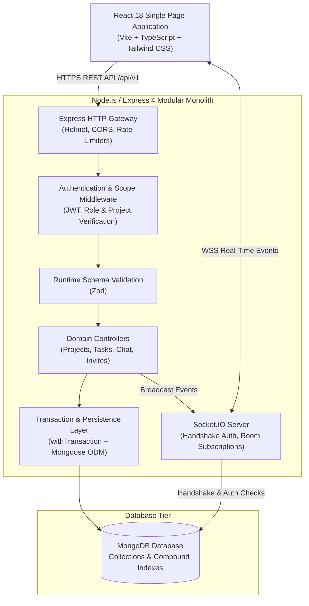
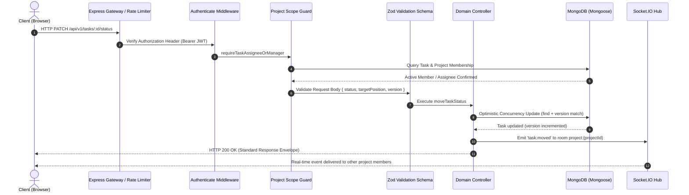
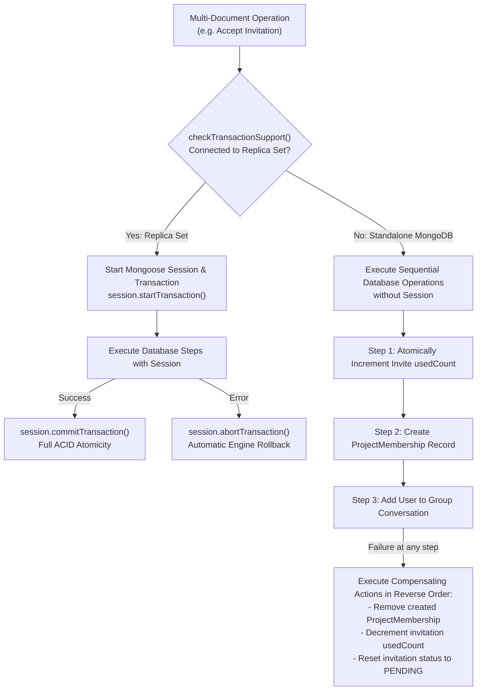

# WorkSpace — System Architecture & Engineering Design

This document details the software architecture, technical decisions, data flow, and concurrency models powering **WorkSpace**.

The authoritative high-level specification is maintained in [`PROJECT_SPEC.md`](PROJECT_SPEC.md). This document complements the specification by detailing implementation-level design patterns and system boundaries.

---

## 1. High-Level Architectural Pattern

WorkSpace is structured as a **modular monolith** divided into a decoupled Single Page Application (SPA) frontend and a unified backend API server that provides both REST endpoints and real-time WebSocket communication over Socket.IO.



### Architectural Principles
1. **Separation of Concerns:** Clear physical boundaries exist between routing (`src/routes`), request parsing and business coordination (`src/controllers`), domain models (`src/models`), input validation (`src/validation`), and security policies (`src/middleware`).
2. **Strict Server-Side Authority:** The frontend never decides permissions or computes authoritative database states. All operations—such as role checks, project access, task positioning, and invitation token consumption—are validated and persisted server-side before confirming.
3. **Optimized Persistence:** High-velocity Kanban card moves utilize $O(1)$ fractional positioning and optimistic concurrency control rather than expensive bulk array updates.
4. **Resilient Transport:** Critical actions (task moves, message submissions, project edits) always persist through standard HTTP REST endpoints first, with real-time events broadcast over WebSockets only after successful database commits.

---

## 2. Frontend Architecture

The frontend is built with **React 18**, **TypeScript**, and **Tailwind CSS**, bundled via **Vite**.

```
client/src/
├── components/          # Reusable UI primitives and domain components
│   ├── chat/            # Real-time message thread and message composer
│   ├── kanban/          # Drag-and-drop board, columns, and task cards
│   ├── layout/          # AppShell, Sidebar, Header, Breadcrumbs
│   ├── projects/        # Project creation modal, invite generator, join requests
│   └── ui/              # Design tokens: Button, Card, Badge, Modal, Input, Spinner
├── context/             # Global React state providers
│   ├── AuthContext.tsx  # JWT lifecycle, user profile, login, logout, registration
│   └── RouterContext.tsx# Browser history navigation with zero external router bloat
├── hooks/               # Custom hooks (e.g. useDebounce)
├── lib/                 # HTTP API client wrappers and Socket.IO client singleton
│   ├── api.ts           # Centralized fetch wrapper with automatic bearer auth
│   ├── projectApi.ts    # Project and membership endpoints
│   ├── taskApi.ts       # Kanban board task and comment endpoints
│   ├── chatApi.ts       # Message history and conversation endpoints
│   ├── notificationApi.ts # Notification management
│   └── socket.ts        # Socket.IO connection lifecycle and event dispatchers
├── pages/               # Top-level route views (Dashboard, Projects, Tasks, etc.)
└── types/               # Strict TypeScript interface and type declarations
```

### Key Frontend Patterns
- **Client-Side Routing (`RouterContext.tsx`):** A lightweight history-based router using native `window.history` and `popstate` events, maintaining route synchronization without introducing heavy external routing dependencies.
- **Global Authentication Lifecycle (`AuthContext.tsx`):** Restores authentication tokens from storage on application boot, verifies the session against `GET /api/v1/auth/me`, and manages automatic header injection and logout cleanups.
- **Design Tokens & UI Kit:** Self-contained, accessible UI primitives (`components/ui/`) styled with Tailwind CSS, supporting dark/light contrast standards, interactive loading states, and customizable alert badges.

---

## 3. Backend Architecture & Request Flow

The backend runs on **Node.js LTS** using **Express 4** (with `@types/express`) and **Mongoose 8+**.

```
server/src/
├── config/              # Environment parsing (Zod), CORS, and MongoDB connectivity
├── controllers/         # Request handling, orchestration, and response formatting
├── errors/              # Centralized AppError class and HTTP status mappings
├── middleware/          # Security headers, rate limiting, JWT auth, project guards
├── models/              # Mongoose schemas, document interfaces, and indexes
├── routes/              # Express Router declarations grouped by domain
├── scripts/             # Admin seeding, demo seeding, and verification CLI utilities
├── sockets/             # Socket.IO initialization, auth middleware, and room handlers
├── tests/               # Automated integration, isolation, and security test suites
├── utils/               # Transaction helpers, fractional indexing, token hashing
└── validation/          # Zod schemas for request bodies and parameters
```

### Standard Request Lifecycle



---

## 4. Real-Time WebSocket Architecture

Real-time capabilities are powered by **Socket.IO 4.8+** integrated into the Node HTTP server.

### 1. Connection & Authentication Handshake
- During connection initialization (`io.use`), the client supplies the JWT token in `socket.handshake.auth.token`.
- The server validates the token signature against `JWT_SECRET`, fetches the active user profile, and binds `socket.data.user`.
- Connections with missing, expired, or invalid tokens are rejected at the TCP/WebSocket handshake boundary.

### 2. Room Isolation Strategy
Clients cannot subscribe to arbitrary rooms by emitting arbitrary client events. Room joining is strictly managed server-side:

| Room Pattern | Purpose | Authorization Policy |
|---|---|---|
| `project:{projectId}` | Real-time Kanban board updates and task moves | User must be an Administrator, the primary PM, or an active `ProjectMembership` holder. |
| `conversation:{conversationId}` | Project group chat channels | User must be an active project member, primary PM, or Organization Administrator. |
| `dm:{conversationId}` | Admin–PM private direct messaging | Strictly restricted to the specific Administrator and Project Manager IDs assigned to the conversation. |
| `user:{userId}` | Targeted personal notifications | Bound to the authenticated user ID of the connected socket. |

---

## 5. Database Concurrency & Positioning Strategy

### 5.1 Fractional Positioning for Kanban Boards
To reorder tasks within or between Kanban columns without re-indexing all sibling cards ($O(N)$ write overhead), WorkSpace uses **fractional positioning**:
- Each task stores a numeric `position` field (IEEE 754 floating-point double).
- When a task is positioned between two adjacent tasks with positions $P_A$ and $P_B$:
  $$P_{\text{new}} = \frac{P_A + P_B}{2}$$
- If moved to the top of a column: $P_{\text{new}} = \frac{P_{\text{first}}}{2}$ (or $P_{\text{first}} - 1000$ if $P_{\text{first}} > 1000$).
- If moved to the bottom of a column: $P_{\text{new}} = P_{\text{last}} + 1000$.
- Newly created tasks default to the bottom of the target column.

#### Deterministic Sorting
To guarantee identical visual ordering across all clients, queries always sort with tiebreakers:
```typescript
Task.find({ projectId, status }).sort({ position: 1, createdAt: 1, _id: 1 });
```

#### Precision Rebalancing
If repeated fractional insertions cause the distance between adjacent tasks to fall below $|P_A - P_B| < 10^{-6}$, a rebalance is triggered for that column, redistributing tasks across clean integer intervals ($1000, 2000, 3000, \dots$) and emitting a `board:rebalanced` event.

### 5.2 Optimistic Concurrency Control (OCC)
To prevent lost updates when two users move or edit the same task card concurrently:
- Each task document tracks an integer `version` field.
- Mutation requests must submit the expected task version.
- The server verifies that the current database version matches the incoming version before committing mutations.
- If a version mismatch occurs (another user modified the card first), the server rejects the mutation with an `HTTP 409 Conflict` error and returns the latest task state so the client can reconcile visually without data loss.

---

## 6. MongoDB Transactions & Standalone Compensation Architecture

WorkSpace coordinates multi-document mutations (such as invitation acceptance and manager reassignments) using an adaptive transaction utility: [`server/src/utils/transaction.ts`](../server/src/utils/transaction.ts).



### Important Technical Distinction: Replica Sets vs. Standalone Instances

| Deployment Environment | Concurrency Mechanism | Guarantees & Limitations |
|---|---|---|
| **Production / MongoDB Atlas / Replica Set** | Native Multi-Document ACID Transactions (`mongoose.startSession()`) | **Full ACID Guarantees:** All multi-document mutations either commit entirely or abort atomically. Concurrent queries cannot observe partial intermediate states. |
| **Local Development / Standalone MongoDB Node** | Application-Level Compensating Operations | **Sequential with Compensating Rollback:** Standalone MongoDB instances do not support multi-document transactions. WorkSpace executes operations step-by-step and applies explicit compensating rollbacks if a downstream step fails. <br/><br/>*Limitation:* Does not guarantee cross-collection isolation against concurrent read queries during execution, and catastrophic process crashes mid-step cannot be auto-rolled back by the database engine. |

For production environments requiring strict multi-document ACID isolation, always connect WorkSpace to a MongoDB replica set deployment.
