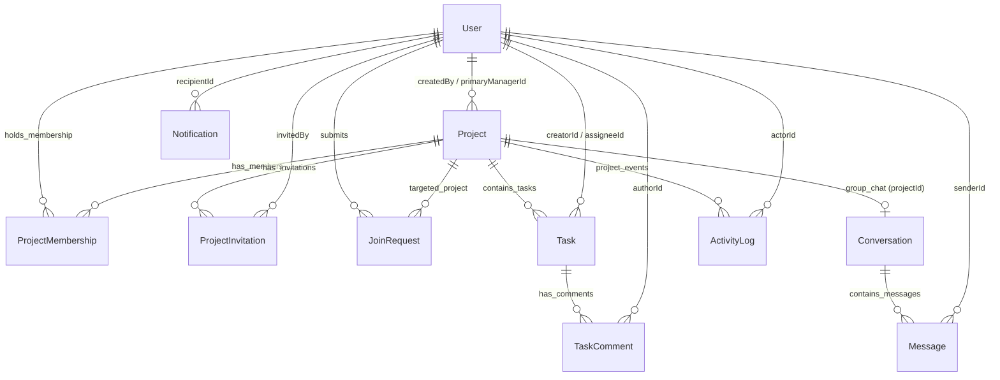

# WorkSpace — Database Schema & Data Models Reference

This document provides a comprehensive technical reference for the MongoDB database collections, Mongoose data models, indexes, and entity relationships powering **WorkSpace**.

The authoritative high-level specification is maintained in [`PROJECT_SPEC.md`](PROJECT_SPEC.md).

---

## 1. Entity-Relationship Overview

---

## 2. Collections & Model Specifications

### 2.1 `User` (`users`)
Represents registered user accounts, authentication credentials, and global authorization roles.

| Field Name | Type | Constraints / Defaults | Description |
|---|---|---|---|
| `_id` | `ObjectId` | Auto-generated PK | Unique user identifier |
| `email` | `String` | Required, Unique, Lowercase, Trim | Normalized user login email |
| `passwordHash` | `String` | Required | Bcrypt password hash (12 salt rounds) |
| `fullName` | `String` | Required, Trim, Max: 100 | Display name of the user |
| `avatarUrl` | `String` | Optional, Default: `null` | Optional external avatar image URL |
| `globalRole` | `String` | Enum: `['ADMIN', 'USER']`, Default: `'USER'` | Global organization authority level |
| `isActive` | `Boolean` | Default: `true` | Account active flag (deactivated users blocked) |
| `createdAt` | `Date` | Timestamp | Account creation timestamp |
| `updatedAt` | `Date` | Timestamp | Last profile update timestamp |

**Indexes:**
- `{ email: 1 }` (Unique compound index)
- `{ globalRole: 1 }`

---

### 2.2 `Project` (`projects`)
Represents an isolated organizational project workspace containing tasks, team members, and conversations.

| Field Name | Type | Constraints / Defaults | Description |
|---|---|---|---|
| `_id` | `ObjectId` | Auto-generated PK | Unique project identifier |
| `name` | `String` | Required, Trim, Max: 100 | Human-readable project title |
| `key` | `String` | Required, Unique, Uppercase, Trim | Short project prefix (e.g., `APOLLO`, `PULSE`) |
| `description` | `String` | Default: `""`, Max: 1000 | Project purpose and scope summary |
| `visibility` | `String` | Enum: `['PUBLIC', 'PRIVATE']`, Default: `'PRIVATE'` | Discoverability setting for non-members |
| `status` | `String` | Enum: `['ACTIVE', 'ARCHIVED']`, Default: `'ACTIVE'` | Project lifecycle status |
| `createdBy` | `ObjectId` | Ref: `'User'`, Required | Admin user who instantiated the project |
| `primaryManagerId` | `ObjectId` | Ref: `'User'`, Required | User holding primary manager status |
| `createdAt` | `Date` | Timestamp | Project creation timestamp |
| `updatedAt` | `Date` | Timestamp | Last project update timestamp |

**Indexes:**
- `{ key: 1 }` (Unique index)
- `{ primaryManagerId: 1 }`
- `{ visibility: 1, status: 1 }` (Optimized for public project browsing)

---

### 2.3 `ProjectMembership` (`projectmemberships`)
Associates a user with a specific project as an active or revoked team member.

| Field Name | Type | Constraints / Defaults | Description |
|---|---|---|---|
| `_id` | `ObjectId` | Auto-generated PK | Unique membership record identifier |
| `projectId` | `ObjectId` | Ref: `'Project'`, Required | Associated project reference |
| `userId` | `ObjectId` | Ref: `'User'`, Required | Associated user reference |
| `role` | `String` | Enum: `['MEMBER']`, Default: `'MEMBER'` | Membership role tier |
| `status` | `String` | Enum: `['ACTIVE', 'REVOKED']`, Default: `'ACTIVE'` | Active status or revoked access flag |
| `joinedAt` | `Date` | Default: `Date.now` | Timestamp when user joined the project |
| `createdAt` | `Date` | Timestamp | Creation timestamp |
| `updatedAt` | `Date` | Timestamp | Last update timestamp |

**Indexes:**
- `{ projectId: 1, userId: 1 }` (**Unique compound index** — prevents duplicate memberships)
- `{ userId: 1, status: 1 }` (Optimized for user project discovery)

---

### 2.4 `ProjectInvitation` (`projectinvitations`)
Tracks cryptographically hashed invitation tokens generated for member onboarding.

| Field Name | Type | Constraints / Defaults | Description |
|---|---|---|---|
| `_id` | `ObjectId` | Auto-generated PK | Unique invitation record identifier |
| `projectId` | `ObjectId` | Ref: `'Project'`, Required | Target project to be joined upon acceptance |
| `tokenHash` | `String` | Required, Unique | SHA-256 hash of the 32-byte secret token |
| `invitedEmail` | `String` | Optional, Lowercase, Trim, Default: `null` | Restricted recipient email, or null for general |
| `invitedBy` | `ObjectId` | Ref: `'User'`, Required | Admin or PM who generated the invitation |
| `expiresAt` | `Date` | Required | Expiration deadline |
| `maxUses` | `Number` | Default: `1`, Min: `1` | Maximum times token can be accepted |
| `usedCount` | `Number` | Default: `0`, Min: `0` | Times token has been accepted |
| `status` | `String` | Enum: `['PENDING', 'ACCEPTED', 'REVOKED', 'EXPIRED']` | Lifecycle state of the invitation |
| `createdAt` | `Date` | Timestamp | Token generation timestamp |
| `updatedAt` | `Date` | Timestamp | Last update timestamp |

**Indexes:**
- `{ tokenHash: 1 }` (Unique index for constant-time lookups)
- `{ projectId: 1, status: 1 }`
- `{ expiresAt: 1 }`

---

### 2.5 `JoinRequest` (`joinrequests`)
Records non-member requests to join public projects, reviewed by an Admin or PM.

| Field Name | Type | Constraints / Defaults | Description |
|---|---|---|---|
| `_id` | `ObjectId` | Auto-generated PK | Unique join request identifier |
| `projectId` | `ObjectId` | Ref: `'Project'`, Required | Target public project |
| `userId` | `ObjectId` | Ref: `'User'`, Required | Requesting user |
| `status` | `String` | Enum: `['PENDING', 'APPROVED', 'REJECTED']`, Default: `'PENDING'` | State of review |
| `reviewedBy` | `ObjectId` | Ref: `'User'`, Default: `null` | Admin or PM who reviewed the request |
| `reviewedAt` | `Date` | Default: `null` | Timestamp of decision |
| `rejectionReason`| `String` | Optional, Default: `null` | Optional reason provided upon rejection |
| `createdAt` | `Date` | Timestamp | Request submission timestamp |
| `updatedAt` | `Date` | Timestamp | Decision update timestamp |

**Indexes:**
- `{ projectId: 1, userId: 1, status: 1 }` (Compound index preventing concurrent duplicate pending requests)
- `{ projectId: 1, status: 1 }`

---

### 2.6 `Task` (`tasks`)
Represents an actionable deliverable on the Kanban board with fractional positioning and OCC.

| Field Name | Type | Constraints / Defaults | Description |
|---|---|---|---|
| `_id` | `ObjectId` | Auto-generated PK | Unique task identifier |
| `projectId` | `ObjectId` | Ref: `'Project'`, Required | Project enclosing this task |
| `title` | `String` | Required, Trim, Max: 200 | Task summary title |
| `description` | `String` | Default: `""`, Max: 5000 | Detailed task description / requirements |
| `status` | `String` | Enum: `['BACKLOG', 'TODO', 'IN_PROGRESS', 'TESTING', 'DONE']` | Current Kanban workflow column |
| `priority` | `String` | Enum: `['LOW', 'MEDIUM', 'HIGH', 'URGENT']`, Default: `'MEDIUM'` | Urgency priority flag |
| `assigneeId` | `ObjectId` | Ref: `'User'`, Default: `null` | Assigned employee user ID |
| `creatorId` | `ObjectId` | Ref: `'User'`, Required | Admin or PM who created the task |
| `dueDate` | `Date` | Optional, Default: `null` | Deadline date for delivery |
| `position` | `Number` | Required | Fractional double for $O(1)$ column ordering |
| `version` | `Number` | Default: `0` | Monotonically increasing OCC version counter |
| `createdAt` | `Date` | Timestamp | Creation timestamp |
| `updatedAt` | `Date` | Timestamp | Last update timestamp |

**Indexes:**
- `{ projectId: 1, status: 1, position: 1 }` (Compound index for deterministic board queries)
- `{ assigneeId: 1, status: 1 }` (Optimized for cross-project user assignment views)

---

### 2.7 `TaskComment` (`taskcomments`)
Represents collaborative discussions and activity updates attached to a specific task card.

| Field Name | Type | Constraints / Defaults | Description |
|---|---|---|---|
| `_id` | `ObjectId` | Auto-generated PK | Unique comment identifier |
| `taskId` | `ObjectId` | Ref: `'Task'`, Required | Parent task |
| `projectId` | `ObjectId` | Ref: `'Project'`, Required | Enclosing project |
| `authorId` | `ObjectId` | Ref: `'User'`, Required | User who authored the comment |
| `content` | `String` | Required, Trim, Max: 2000 | Comment body text |
| `createdAt` | `Date` | Timestamp | Comment creation timestamp |
| `updatedAt` | `Date` | Timestamp | Comment edit timestamp |

**Indexes:**
- `{ taskId: 1, createdAt: 1 }` (Ascending chronological order)

---

### 2.8 `Conversation` (`conversations`)
Defines an isolated group or direct-messaging communication room.

| Field Name | Type | Constraints / Defaults | Description |
|---|---|---|---|
| `_id` | `ObjectId` | Auto-generated PK | Unique conversation identifier |
| `type` | `String` | Enum: `['PROJECT_GROUP', 'ADMIN_PM_DM']`, Required | Channel isolation type |
| `projectId` | `ObjectId` | Ref: `'Project'`, Default: `null` | Null for direct messages; populated for group chats |
| `participants` | `[ObjectId]`| Ref: `'User'` | Array of authorized user IDs |
| `lastMessageAt`| `Date` | Default: `Date.now` | Timestamp of latest message for sorting |
| `createdAt` | `Date` | Timestamp | Creation timestamp |
| `updatedAt` | `Date` | Timestamp | Last update timestamp |

**Indexes:**
- `{ type: 1, projectId: 1 }`
- `{ participants: 1 }`

---

### 2.9 `Message` (`messages`)
Individual chat message records within a conversation.

| Field Name | Type | Constraints / Defaults | Description |
|---|---|---|---|
| `_id` | `ObjectId` | Auto-generated PK | Unique message identifier |
| `conversationId` | `ObjectId` | Ref: `'Conversation'`, Required | Enclosing conversation channel |
| `senderId` | `ObjectId` | Ref: `'User'`, Required | Author of the message |
| `content` | `String` | Required, Trim, Max: 4000 | Plain text message payload |
| `readBy` | `Array` | Subdocuments: `{ userId, readAt }` | Read receipt tracking list |
| `createdAt` | `Date` | Timestamp | Message timestamp |
| `updatedAt` | `Date` | Timestamp | Edit timestamp |

**Indexes:**
- `{ conversationId: 1, createdAt: -1 }` (Optimized for reverse-chronological pagination)

---

### 2.10 `Notification` (`notifications`)
In-app alerts and notifications delivered to specific users.

| Field Name | Type | Constraints / Defaults | Description |
|---|---|---|---|
| `_id` | `ObjectId` | Auto-generated PK | Unique notification identifier |
| `recipientId` | `ObjectId` | Ref: `'User'`, Required | Target user |
| `type` | `String` | Enum: `['TASK_ASSIGNED', 'TASK_STATUS_CHANGED', 'JOIN_REQUEST_CREATED', 'JOIN_REQUEST_RESOLVED', 'INVITATION_RECEIVED']` | Notification event category |
| `title` | `String` | Required | Notification headline |
| `body` | `String` | Required | Explanatory message |
| `link` | `String` | Default: `""` | Optional relative UI route link |
| `isRead` | `Boolean` | Default: `false` | Read status |
| `createdAt` | `Date` | Timestamp | Delivery timestamp |

**Indexes:**
- `{ recipientId: 1, isRead: 1, createdAt: -1 }`

---

### 2.11 `ActivityLog` (`activitylogs`)
Audit history stream recording administrative, project, and task mutations.

| Field Name | Type | Constraints / Defaults | Description |
|---|---|---|---|
| `_id` | `ObjectId` | Auto-generated PK | Unique audit log identifier |
| `projectId` | `ObjectId` | Ref: `'Project'`, Required | Associated project reference |
| `actorId` | `ObjectId` | Ref: `'User'`, Required | User who performed the mutation |
| `action` | `String` | Required | Mutation action key (e.g. `TASK_MOVED`, `MEMBER_JOINED`) |
| `entityType` | `String` | Enum: `['PROJECT', 'TASK', 'MEMBERSHIP', 'INVITATION']` | Modified entity class |
| `entityId` | `ObjectId` | Required | ID of the affected entity |
| `metadata` | `Object` | Default: `{}` | Contextual payload (titles, statuses, before/after values) |
| `createdAt` | `Date` | Timestamp | Audit entry timestamp |

**Indexes:**
- `{ projectId: 1, createdAt: -1 }`

---

## 3. Data Integrity & Concurrency Patterns

1. **Unique Email Invariant:** Enforced at both the Mongoose schema layer and MongoDB unique B-tree index level on `User.email`.
2. **Deterministic Compound Uniqueness:**
   - `ProjectMembership`: `{ projectId: 1, userId: 1 }` guarantees a user cannot hold duplicate membership rows in the same project.
   - `ProjectInvitation`: `{ tokenHash: 1 }` guarantees token collision resistance.
3. **Optimistic Concurrency Control (OCC):**
   - Implemented via `Task.version`. Mutations check `{ _id: taskId, version: expectedVersion }` and atomically increment `version`. If the document version changed concurrently, `409 Conflict` is returned.
4. **Fractional Position Indexing:**
   - Double-precision floating-point numbers order cards without altering sibling rows. Precision rebalancing automatically re-indexes cards if the gap narrows below $10^{-6}$.
