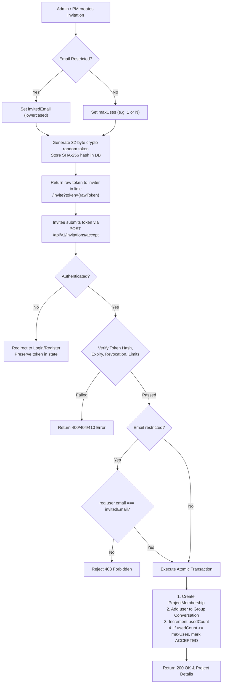
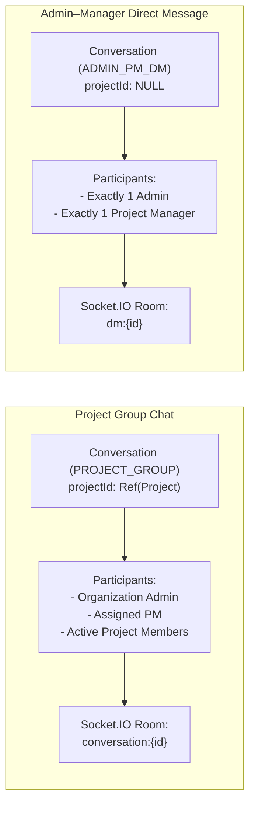
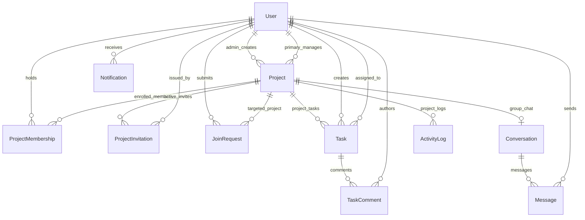

# WorkSpace — Complete Technical Specification & System Architecture

**Document Version:** 1.1.0  
**Status:** Approved Specification  
**Target Platform:** Web (React + Express + Node.js + MongoDB + Socket.IO)  
**Author:** Senior Architecture Team & Core Engineering

---

## 1. Project Overview & Core Mission

**WorkSpace** is a multi-project, real-time team collaboration and project management SaaS platform. The system is designed to provide seamless visual task tracking via Kanban workflows alongside real-time contextual communication (group chats and private direct messaging).

The system is engineered as a secure, production-grade modular monolith adhering to clean architecture principles:
- **Separation of Concerns:** Clear boundaries between routing, authentication, validation, business logic (services), data persistence (models), and real-time transport (Socket.IO).
- **Zero Premature Distributed Complexity:** No microservices, message queues, or Redis in the initial MVP. Local execution requires only Node.js, npm, and a MongoDB instance.
- **Strict Server-Side Authority:** Clients never make authorization decisions, calculate positions authoritatively, or validate invitation tokens locally. All invariants are enforced on the server.

---

## 2. Technology Stack

### Frontend
- **Framework:** React 18+ with TypeScript
- **Build Tool:** Vite
- **State Management & Data Fetching:** React Context / Custom Hooks with Axios / Fetch API
- **Styling:** Tailwind CSS
- **Real-Time Client:** Socket.IO Client

### Backend
- **Runtime:** Node.js (LTS)
- **Framework:** Express.js with TypeScript
- **Validation:** Zod (runtime validation for HTTP payloads, query params, and environment variables)
- **Authentication & Cryptography:** JSON Web Tokens (JWT), bcryptjs for password hashing, Node.js `crypto` for SHA-256 token hashing
- **Real-Time Engine:** Socket.IO Server

### Database & Persistence
- **Database:** MongoDB
- **ODM:** Mongoose 8+
- **Data Integrity:** ACID Transactions (for multi-document operations such as invitation acceptance and manager reassignment) and Atomic Operators (`findOneAndUpdate`, `$inc`, `$set`)

### Testing & Tooling
- **Testing:** Node.js Test Runner / Vitest with Supertest for integration and route testing
- **API Verification:** Postman Collections with pre-request scripts and automated assertion tests
- **Version Control:** Git

---

## 3. User Roles, Scopes, and Permission Model

WorkSpace distinguishes strictly between **Global Account Roles** and **Project Scopes**.

### 3.1 Global Identity Roles
Stored on the `User` record (`user.globalRole`):
1. **`ADMIN` (Organization Administrator):**
   - Global superuser authority across all projects, task boards, and group chats.
   - Exclusive ability to create new projects.
   - Exclusive ability to assign, replace, or demote primary project managers.
   - Exclusive ability to toggle project visibility (`PUBLIC` vs. `PRIVATE`).
   - Private 1-on-1 direct messaging channel with any project manager.
2. **`USER` (Standard User / Employee):**
   - The default role assigned to all publicly registered accounts.
   - Possesses no global administrative capabilities.
   - Access to project-level resources is strictly governed by project context.

### 3.2 Contextual Project Scopes
For any user where `globalRole === 'USER'`, project capabilities are resolved dynamically per project:
1. **Primary Project Manager:**
   - Evaluated as `project.primaryManagerId.equals(user._id)`.
   - Exactly one primary manager exists per project.
   - Can manage project members, review join requests, issue invitations, create/edit/reassign all tasks, manage column statuses, and access project group chat.
   - Can participate in a private direct message conversation with the Organization Administrator.
   - Cannot create projects, change project visibility, or assign other managers.
2. **Active Project Employee (Member):**
   - Evaluated via an active document in `ProjectMembership` with `status: 'ACTIVE'`.
   - Can access the project Kanban board and project group chat.
   - Can update the status/column of **tasks assigned to them**.
   - Can comment on tasks within the project.
   - Cannot create tasks, reassign tasks, invite users, or approve join requests.
3. **Non-Member (Discoverer / Requester):**
   - Authenticated user with no active membership in the project.
   - Can view limited public metadata for projects where `visibility === 'PUBLIC'`.
   - Can submit a single pending `JoinRequest` for public projects.
   - Cannot view tasks, comments, group chat messages, or activity logs.

### 3.3 Unified Permission Matrix

| Action / Capability | Administrator (`ADMIN`) | Primary Project Manager | Active Employee Member | Non-Member User |
| :--- | :---: | :---: | :---: | :---: |
| **Create New Project** | **Yes** (Exclusive) | No | No | No |
| **Assign / Change Primary PM** | **Yes** (Exclusive) | No | No | No |
| **Change Project Visibility** | **Yes** (Exclusive) | No | No | No |
| **Browse Public Project Metadata** | Yes | Yes | Yes | **Yes** |
| **Browse Private Projects** | Yes | Assigned Only | Joined Only | **No (Hidden)** |
| **Submit Join Request** | N/A | N/A | N/A | **Yes (Public Only)** |
| **Approve / Reject Join Request** | Yes | **Yes** (Assigned Project) | No | No |
| **Generate Invitation Links** | Yes | **Yes** (Assigned Project) | No | No |
| **Accept Invitation Link** | Yes | Yes | Already Member | **Yes** |
| **Access Project Kanban Board** | Yes | Yes | Yes | No |
| **Create New Tasks** | Yes | Yes | No | No |
| **Edit Any Task / Reassign** | Yes | Yes | No | No |
| **Move Status of Assigned Task** | Yes | Yes | **Yes** | No |
| **Move Status of Unassigned Task** | Yes | Yes | No | No |
| **Comment on Project Tasks** | Yes | Yes | Yes | No |
| **Access Project Group Chat** | Yes | Yes | Yes | No |
| **Admin–PM Direct Message** | Yes (Any PM) | Yes (With Admin Only) | No | No |

---

## 4. Project Governance, Visibility, and Manager Lifecycle

### 4.1 Project Model & Visibility Policy
Every project contains:
- `name` (String, required)
- `key` (String, unique uppercase identifier, e.g., "PRJ", "ALPHA")
- `description` (String)
- `visibility` (`"PUBLIC"` | `"PRIVATE"`, default: `"PRIVATE"`)
- `status` (`"ACTIVE"` | `"ARCHIVED"`, default: `"ACTIVE"`)
- `createdBy` (ObjectId referencing Admin)
- `primaryManagerId` (ObjectId referencing User)
- Timestamps (`createdAt`, `updatedAt`)

#### Visibility Rules:
- **Default:** All newly created projects default to `PRIVATE`.
- **Modification:** Only users with `globalRole === 'ADMIN'` may modify project visibility.
- **Public Projects:** Non-members can view limited metadata:
  1. Project Name
  2. Project Key
  3. Description
  4. Primary Manager's Full Name
  5. Active Member Count
- **Private Projects:** Completely invisible to non-members in the project directory. They cannot be discovered or requested via browsing. Joining a private project requires an authorized invitation link.
- **Data Protection:** Discoverability never exposes internal project resources (tasks, chat, comments, activity logs).

### 4.2 Primary Project Manager Assignment and Demotion
- Every project must maintain **exactly one primary manager** at all times.
- Only the Administrator can replace the primary manager.
- **Demotion Policy:**
  - When the Administrator designates a new primary manager:
    1. The outgoing manager loses project management privileges.
    2. If the outgoing manager remains an eligible user account, their project membership is automatically retained as an active regular employee (`role: 'MEMBER'`, `status: 'ACTIVE'` in `ProjectMembership`).
    3. If the outgoing manager has been deactivated or flagged ineligible, their membership is revoked (`status: 'REVOKED'`).
    4. The incoming manager is validated: they must exist, have an active account, and be assigned `primaryManagerId`. If they do not already possess a `ProjectMembership`, one is created.
  - **Atomicity:** Manager replacement and membership synchronization must execute within a MongoDB database transaction.
  - **Audit Logging:** An `ActivityLog` entry of type `'MANAGER_REPLACED'` is recorded with the admin's ID, previous manager's ID, and new manager's ID.
  - **Socket & Token Security:** Authorization middleware must always verify the current `project.primaryManagerId` from the database/cache, rather than relying on stale JWT claims or persistent socket connection state.

---

## 5. Member Onboarding: Invitations and Join Requests

WorkSpace provides two separate entry paths: **Invitations** and **Join Requests**.

### 5.1 Invitation Architecture & Security Policy



#### Key Invitation Rules:
1. **Token Security:** Raw tokens are never stored in MongoDB. The server generates a cryptographically secure random token (32 bytes hex), computes its SHA-256 hash, and stores `tokenHash`. Lookup is executed by hashing the incoming token and performing constant-time matching.
2. **Dual Types:**
   - **Email-Restricted:** `invitedEmail` is populated. The backend checks `req.user.email.toLowerCase() === invitation.invitedEmail.toLowerCase()`. Frontend-provided emails are strictly ignored.
   - **General Invitations:** `invitedEmail` is null. Any authenticated user holding the link may join, constrained by `maxUses` (default: 1) and `expiresAt`.
3. **Usage Tracking & Concurrency:**
   - An invitation record maintains `usedCount` and `maxUses`.
   - Single-use invitations (`maxUses: 1`) transition to `status: 'ACCEPTED'` upon consumption.
   - Reusable invitations (`maxUses > 1`) remain valid until `usedCount === maxUses` or until expired/revoked.
   - Atomic consumption is enforced using `findOneAndUpdate` with condition `{ tokenHash, status: { $in: ['PENDING', 'ACCEPTED'] }, usedCount: { $lt: maxUses }, expiresAt: { $gt: new Date() } }` and operator `{ $inc: { usedCount: 1 } }` inside a MongoDB session transaction.
4. **Unified Acceptance Endpoint:**
   - Both registered and newly registered users converge on `POST /api/v1/invitations/accept`.
   - Opening an invitation URL never grants access by itself.
   - The frontend preserves the invitation token across registration/login flows and submits it only after authentication tokens are acquired.

### 5.2 Employee Join-Request Lifecycle
1. **Initiation:** An authenticated user submits `POST /api/v1/projects/:id/join-requests`.
2. **Validation:**
   - Project must have `visibility === 'PUBLIC'`.
   - User must not already be an active member.
   - User must not have an existing `PENDING` request for that project (enforced by a compound unique index on `{ projectId: 1, userId: 1, status: 1 }`).
3. **Review Authority:** Either the Organization Administrator or the assigned Primary Project Manager may review the request.
4. **Race-Condition Safe Decision:**
   - Reviewer calls `PATCH /api/v1/join-requests/:requestId/approve` or `reject`.
   - State transition utilizes atomic locking:
     ```typescript
     const request = await JoinRequest.findOneAndUpdate(
       { _id: requestId, status: 'PENDING' },
       { status: decision, reviewedBy: req.user._id, reviewedAt: new Date() },
       { new: true }
     );
     ```
   - If `request` is null, the request was already resolved by the other authority; the backend returns `409 Conflict ("Join request already resolved")`.
   - On approval, a `ProjectMembership` document is created, the user is added to the project group conversation, and a real-time notification is dispatched.

---

## 6. Real-Time Kanban Board Architecture

### 6.1 Fixed Column Workflows
The MVP enforces **five fixed system statuses**:
1. `BACKLOG`
2. `TODO`
3. `IN_PROGRESS`
4. `TESTING`
5. `DONE`

*Extensibility Note:* The status field is typed as an enum at the application boundary, but project tasks reference this state cleanly so that future versions can introduce project-specific custom workflow columns without schema rewrites.

### 6.2 Task Ordering via Fractional Positioning
To eliminate $O(N)$ re-indexing of sibling tasks when a card is dragged and dropped, WorkSpace utilizes **fractional positioning**:
- Each task stores a numeric `position` field (IEEE 754 floating-point double).
- When a task is moved between two tasks with positions $P_A$ and $P_B$, the new position is calculated as:
  $$P_{\text{new}} = \frac{P_A + P_B}{2}$$
- If moved to the top of a column, $P_{\text{new}} = \frac{P_{\text{first}}}{2}$ (or $P_{\text{first}} - 1000$ if $P_{\text{first}} > 1000$).
- If moved to the bottom, $P_{\text{new}} = P_{\text{last}} + 1000$.
- Newly created tasks default to the bottom of the target column.

#### Deterministic Ordering:
Queries for board columns always sort deterministically:
`sort({ position: 1, createdAt: 1, _id: 1 })`

#### Rebalancing Strategy:
When the gap between adjacent tasks becomes too small ($|P_A - P_B| < 10^{-6}$), floating-point precision degradation can occur.
- **Trigger:** If $|P_A - P_B| < 10^{-6}$ during position calculation, a background rebalance is initiated for that specific project column.
- **Execution:** Within a transaction, all tasks in `{ projectId, status }` are ordered by `position ASC` and reassigned evenly spaced integer positions ($1000, 2000, 3000, \dots$).
- **Client Synchronization:** A `board:rebalanced` event is broadcast to the project room with refreshed positions.

### 6.3 Concurrency Control and Stale Drag-and-Drop
- Every task document tracks an optimistic concurrency version (`version` or Mongoose `__v`).
- When a client initiates a status or position move, it sends the task's expected version.
- If the server detects that the task has been modified by another user concurrently, it rejects the update with `409 Conflict` and supplies the latest task state, preventing accidental overwrites.
- The server validates:
  1. Requester is Admin, PM, or the task's assigned employee.
  2. The destination status is valid.
  3. The task belongs to the claimed project.
- **Persistence Guarantee:** Changes are committed to MongoDB before any Socket.IO event (`task:moved` or `task:updated`) is broadcast to connected clients in room `project:{projectId}`.

---

## 7. Real-Time Chat System

WorkSpace provides two isolated conversation contexts.



### 7.1 Project Group Chat
- Created automatically upon project creation.
- Bound to `projectId`.
- Participants include the Admin, the Primary PM, and all active `ProjectMembership` holders.
- When an employee is removed or leaves a project, they are immediately evicted from the conversation participants and their active socket is ejected from room `conversation:{id}`.

### 7.2 Administrator–Manager Direct Messaging
- 1-on-1 private conversation between the Admin and a specific Project Manager.
- `projectId` is explicitly omitted/null to ensure DM conversations are completely invisible to project queries.
- Only the two participating user IDs can fetch message history, send messages, or receive real-time events.

### 7.3 Message Persistence and Real-Time Delivery
- Messages are submitted via REST `POST /api/v1/conversations/:id/messages`.
- Content is validated via Zod (length, non-empty, sanitized text).
- Message is saved to MongoDB in the `Message` collection and updates `Conversation.lastMessageAt`.
- After successful persistence, the message payload is emitted via Socket.IO to the authorized conversation room.
- Message history is retrieved via cursor-based or reverse-chronological pagination (`GET /api/v1/conversations/:id/messages?limit=50&before=TIMESTAMP`).

---

## 8. Database Architecture & Schema Specifications



### Complete Collection Schemas & Index Strategy

#### 1. `User`
```typescript
{
  _id: ObjectId,
  email: { type: String, required: true, unique: true, lowercase: true, trim: true },
  passwordHash: { type: String, required: true },
  fullName: { type: String, required: true, trim: true },
  avatarUrl: { type: String, default: null },
  globalRole: { type: String, enum: ['ADMIN', 'USER'], default: 'USER' },
  isActive: { type: Boolean, default: true },
  createdAt: Date,
  updatedAt: Date
}
```
- **Indexes:**
  - `{ email: 1 }` (Unique)
  - `{ globalRole: 1 }`

#### 2. `Project`
```typescript
{
  _id: ObjectId,
  name: { type: String, required: true, trim: true },
  key: { type: String, required: true, unique: true, uppercase: true, trim: true },
  description: { type: String, default: '' },
  visibility: { type: String, enum: ['PUBLIC', 'PRIVATE'], default: 'PRIVATE' },
  status: { type: String, enum: ['ACTIVE', 'ARCHIVED'], default: 'ACTIVE' },
  createdBy: { type: ObjectId, ref: 'User', required: true },
  primaryManagerId: { type: ObjectId, ref: 'User', required: true },
  createdAt: Date,
  updatedAt: Date
}
```
- **Indexes:**
  - `{ key: 1 }` (Unique)
  - `{ primaryManagerId: 1 }`
  - `{ visibility: 1, status: 1 }` (Optimized for public project browsing)

#### 3. `ProjectMembership`
```typescript
{
  _id: ObjectId,
  projectId: { type: ObjectId, ref: 'Project', required: true },
  userId: { type: ObjectId, ref: 'User', required: true },
  role: { type: String, enum: ['MEMBER'], default: 'MEMBER' },
  status: { type: String, enum: ['ACTIVE', 'REVOKED'], default: 'ACTIVE' },
  joinedAt: { type: Date, default: Date.now },
  createdAt: Date,
  updatedAt: Date
}
```
- **Indexes:**
  - `{ projectId: 1, userId: 1 }` (**Unique compound index**)
  - `{ userId: 1, status: 1 }`

#### 4. `ProjectInvitation`
```typescript
{
  _id: ObjectId,
  projectId: { type: ObjectId, ref: 'Project', required: true },
  tokenHash: { type: String, required: true, unique: true },
  invitedEmail: { type: String, lowercase: true, trim: true, default: null },
  invitedBy: { type: ObjectId, ref: 'User', required: true },
  expiresAt: { type: Date, required: true },
  maxUses: { type: Number, default: 1 },
  usedCount: { type: Number, default: 0 },
  status: { type: String, enum: ['PENDING', 'ACCEPTED', 'REVOKED', 'EXPIRED'], default: 'PENDING' },
  createdAt: Date,
  updatedAt: Date
}
```
- **Indexes:**
  - `{ tokenHash: 1 }` (Unique)
  - `{ projectId: 1, status: 1 }`
  - `{ expiresAt: 1 }`

#### 5. `JoinRequest`
```typescript
{
  _id: ObjectId,
  projectId: { type: ObjectId, ref: 'Project', required: true },
  userId: { type: ObjectId, ref: 'User', required: true },
  status: { type: String, enum: ['PENDING', 'APPROVED', 'REJECTED'], default: 'PENDING' },
  reviewedBy: { type: ObjectId, ref: 'User', default: null },
  reviewedAt: { type: Date, default: null },
  rejectionReason: { type: String, default: null },
  createdAt: Date,
  updatedAt: Date
}
```
- **Indexes:**
  - `{ projectId: 1, userId: 1, status: 1 }` (Compound index)
  - `{ projectId: 1, status: 1 }`

#### 6. `Task`
```typescript
{
  _id: ObjectId,
  projectId: { type: ObjectId, ref: 'Project', required: true },
  title: { type: String, required: true, trim: true },
  description: { type: String, default: '' },
  status: { type: String, enum: ['BACKLOG', 'TODO', 'IN_PROGRESS', 'TESTING', 'DONE'], default: 'BACKLOG' },
  priority: { type: String, enum: ['LOW', 'MEDIUM', 'HIGH', 'URGENT'], default: 'MEDIUM' },
  assigneeId: { type: ObjectId, ref: 'User', default: null },
  creatorId: { type: ObjectId, ref: 'User', required: true },
  dueDate: { type: Date, default: null },
  position: { type: Number, required: true },
  version: { type: Number, default: 0 },
  createdAt: Date,
  updatedAt: Date
}
```
- **Indexes:**
  - `{ projectId: 1, status: 1, position: 1 }` (Compound index for Kanban board ordering)
  - `{ assigneeId: 1, status: 1 }` (For cross-project "My Tasks" view)

#### 7. `TaskComment`
```typescript
{
  _id: ObjectId,
  taskId: { type: ObjectId, ref: 'Task', required: true },
  projectId: { type: ObjectId, ref: 'Project', required: true },
  authorId: { type: ObjectId, ref: 'User', required: true },
  content: { type: String, required: true, trim: true },
  createdAt: Date,
  updatedAt: Date
}
```
- **Indexes:**
  - `{ taskId: 1, createdAt: 1 }`

#### 8. `Conversation`
```typescript
{
  _id: ObjectId,
  type: { type: String, enum: ['PROJECT_GROUP', 'ADMIN_PM_DM'], required: true },
  projectId: { type: ObjectId, ref: 'Project', default: null },
  participants: [{ type: ObjectId, ref: 'User' }],
  lastMessageAt: { type: Date, default: Date.now },
  createdAt: Date,
  updatedAt: Date
}
```
- **Indexes:**
  - `{ type: 1, projectId: 1 }`
  - `{ participants: 1 }`

#### 9. `Message`
```typescript
{
  _id: ObjectId,
  conversationId: { type: ObjectId, ref: 'Conversation', required: true },
  senderId: { type: ObjectId, ref: 'User', required: true },
  content: { type: String, required: true, trim: true },
  readBy: [{
    userId: { type: ObjectId, ref: 'User' },
    readAt: { type: Date, default: Date.now }
  }],
  createdAt: Date,
  updatedAt: Date
}
```
- **Indexes:**
  - `{ conversationId: 1, createdAt: -1 }` (Compound index for reverse-chronological chat pagination)

#### 10. `Notification`
```typescript
{
  _id: ObjectId,
  recipientId: { type: ObjectId, ref: 'User', required: true },
  type: { 
    type: String, 
    enum: ['TASK_ASSIGNED', 'TASK_STATUS_CHANGED', 'JOIN_REQUEST_CREATED', 'JOIN_REQUEST_RESOLVED', 'INVITATION_RECEIVED'],
    required: true 
  },
  title: { type: String, required: true },
  body: { type: String, required: true },
  link: { type: String, default: '' },
  isRead: { type: Boolean, default: false },
  createdAt: Date
}
```
- **Indexes:**
  - `{ recipientId: 1, isRead: 1, createdAt: -1 }`

#### 11. `ActivityLog`
```typescript
{
  _id: ObjectId,
  projectId: { type: ObjectId, ref: 'Project', required: true },
  actorId: { type: ObjectId, ref: 'User', required: true },
  action: { type: String, required: true },
  entityType: { type: String, enum: ['PROJECT', 'TASK', 'MEMBERSHIP', 'INVITATION'], required: true },
  entityId: { type: ObjectId, required: true },
  metadata: { type: Object, default: {} },
  createdAt: Date
}
```
- **Indexes:**
  - `{ projectId: 1, createdAt: -1 }`

---

## 9. Security Architecture & Server-Side Enforcement

### 9.1 Initial Admin Bootstrap Command
- **Requirement:** The first Organization Administrator cannot be created via public HTTP registration.
- **Implementation:** A standalone CLI script executed server-side:
  ```bash
  npm run seed:admin
  ```
- **Credentials:** Reads `ADMIN_EMAIL`, `ADMIN_PASSWORD`, and `ADMIN_NAME` from validated environment variables.
- **Validation:**
  - Enforces strong password rules (minimum 8 characters, letters, numbers, symbols).
  - Hashes the password with `bcryptjs` (cost factor: 12).
- **Idempotency & Re-run Safety:**
  - Script checks `User.findOne({ globalRole: 'ADMIN' })`.
  - If an Admin already exists, the script aborts cleanly with an informative message without modifying records or creating duplicates.
  - Ordinary registration routes (`POST /api/v1/auth/register`) strictly hardcode `globalRole: 'USER'` and ignore client-supplied role values.

### 9.2 Authorization Layer (RBAC & Scoping)
- Every authenticated request runs through `authenticate` middleware, which parses the JWT bearer token, checks signature and expiration, and attaches `req.user`.
- Context-aware authorization middlewares:
  - `requireAdmin`: Enforces `req.user.globalRole === 'ADMIN'`.
  - `requireProjectAccess`: Verifies that `req.user` is either Admin, Primary PM, or holds an active `ProjectMembership` for the specified `projectId`.
  - `requireProjectManager`: Verifies that `req.user` is either Admin or the assigned `primaryManagerId` for that project.
  - `requireTaskAssigneeOrManager`: Verifies that the user attempting to move or edit a task is the assigned employee, the project's PM, or an Admin.

### 9.3 Socket.IO Handshake Authentication & Room Security
- WebSockets use a JWT handshake interceptor:
  ```typescript
  io.use((socket, next) => {
    const token = socket.handshake.auth?.token;
    // verify JWT, verify user isActive, attach socket.data.user
  });
  ```
- Clients cannot subscribe to arbitrary rooms by emitting client events. All room subscriptions (`socket.join`) occur through verified server-side event handlers checking project membership in MongoDB.

---

## 10. REST API Directory (`/api/v1`)

### Standard Response Envelope
All HTTP endpoints return responses conforming to:
```typescript
{
  success: boolean;
  data?: T;
  error?: {
    code: string;
    message: string;
    details?: any;
  };
  timestamp: string;
}
```

### Route Summary

#### Authentication & Profile (`/api/v1/auth`)
- `POST /register`: Register a new employee account (`globalRole: 'USER'`).
- `POST /login`: Authenticate email and password, return JWT token.
- `GET /me`: Return authenticated user profile and permissions.

#### Projects (`/api/v1/projects`)
- `POST /`: (Admin only) Create project and assign initial primary manager.
- `GET /`: List projects (Admin: all; PM/Employee: joined projects; Non-members: public projects with limited metadata).
- `GET /:id`: Fetch detailed project data (Members only).
- `PATCH /:id/visibility`: (Admin only) Update project visibility (`PUBLIC` vs `PRIVATE`).
- `PATCH /:id/primary-manager`: (Admin only) Reassign primary manager with automated member demotion.

#### Memberships & Join Requests (`/api/v1/projects/:id/...` & `/api/v1/...`)
- `GET /projects/:id/members`: List active project members.
- `DELETE /projects/:id/members/:userId`: Remove employee from project (Admin/PM).
- `POST /projects/:id/join-requests`: Submit a join request for a public project.
- `GET /projects/:id/join-requests`: List pending join requests (Admin/PM).
- `PATCH /join-requests/:id/approve`: Approve join request atomically.
- `PATCH /join-requests/:id/reject`: Reject join request atomically.

#### Invitations (`/api/v1/invitations`)
- `POST /`: Generate invitation link (Admin/PM). Accepts `{ projectId, invitedEmail?, maxUses?, expiresInDays? }`.
- `POST /accept`: Authenticated acceptance of an invitation token (`{ token }`).

#### Tasks & Kanban (`/api/v1/projects/:id/tasks` & `/api/v1/tasks/:id`)
- `GET /projects/:id/tasks`: Fetch all tasks ordered by `status` and `position`.
- `POST /projects/:id/tasks`: Create task (Admin/PM).
- `PATCH /tasks/:id`: Update task details/assignee (Admin/PM).
- `PATCH /tasks/:id/status`: Update task status and position (Admin, PM, or assigned employee).
- `DELETE /tasks/:id`: Delete task (Admin/PM).
- `GET /tasks/:id/comments`: Fetch task comments.
- `POST /tasks/:id/comments`: Post comment on task (Active members).

#### Conversations & Messages (`/api/v1/conversations`)
- `GET /project/:projectId`: Fetch or create project group conversation.
- `GET /admin-pm/:managerId`: (Admin/PM only) Fetch or create private Admin–PM direct message.
- `GET /:id/messages`: Paginated message retrieval.
- `POST /:id/messages`: Post message and trigger real-time broadcast.

#### Notifications (`/api/v1/notifications`)
- `GET /`: Fetch recipient's notifications.
- `PATCH /:id/read`: Mark single notification as read.
- `PATCH /read-all`: Mark all notifications as read.

---

## 11. Phased Implementation Roadmap

1. **Phase 1: Backend Foundation & Health Check**
   - Package setup, TypeScript config, Zod environment validation, Mongoose connection with graceful shutdown, centralized error middleware, `GET /api/v1/health`.
2. **Phase 2: Authentication, Profile & Admin Seeding**
   - User schema with bcrypt, JWT middleware, registration, login, `/me`, and idempotent CLI seed script for initial Admin.
3. **Phase 3: Projects, Visibility & Manager Assignment**
   - Project schema, Admin project creation, visibility toggle, primary manager assignment, and atomic manager demotion logic.
4. **Phase 4: Memberships, Invitations & Join Requests**
   - Token-hashed invitations (email-restricted + general), unified acceptance transaction, concurrent-safe join requests.
5. **Phase 5: Kanban Tasks, Fractional Positioning & Comments**
   - Task schema with 5 fixed statuses, fractional positioning, concurrency control, comments, activity logging.
6. **Phase 6: Socket.IO Server & Real-Time Board Synchronization**
   - Socket JWT authentication, project room management, real-time board update broadcasts.
7. **Phase 7: Real-Time Chat (Group Chat & Isolated Admin–PM DM)**
   - Conversation and Message models, paginated history endpoints, real-time message broadcasting with room isolation.
8. **Phase 8: Notifications & Activity Feeds**
   - Notification triggers, unread badges, real-time socket delivery.
9. **Phase 9: Automated Testing Suite & Security Hardening**
   - Supertest integration tests for BOLA, concurrency, and validation; rate limiting, helmet headers.
10. **Phase 10: Frontend Integration (React + Vite + TypeScript)**
    - React UI, Kanban drag-and-drop, Socket.IO client, chat panels.
